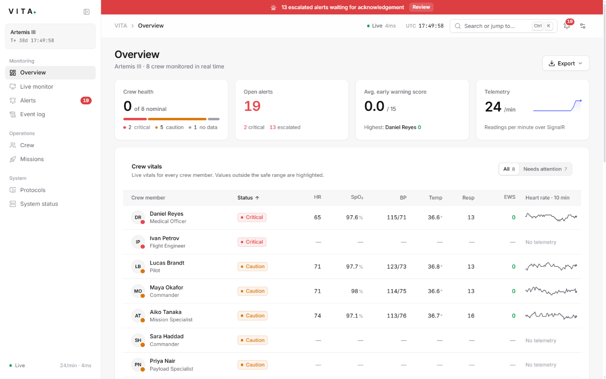
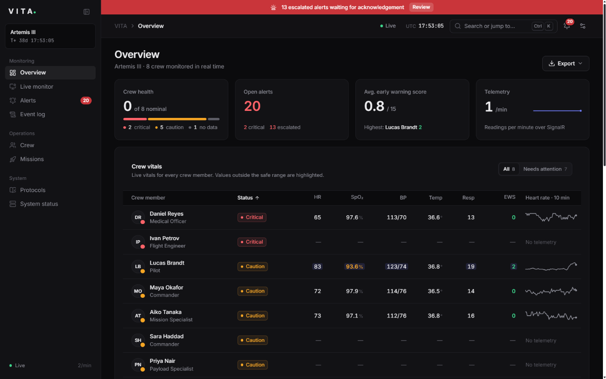
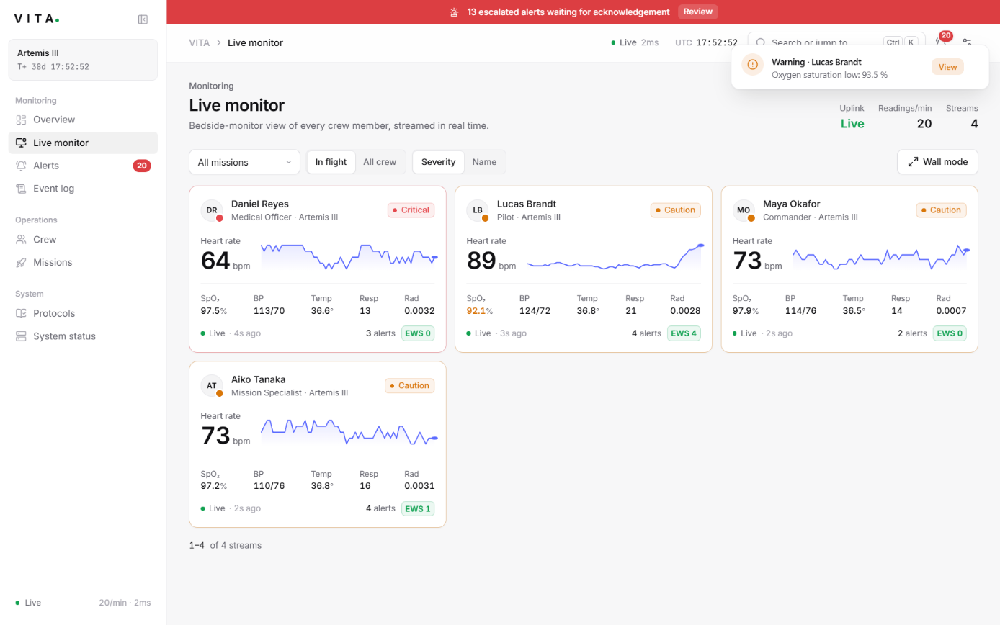
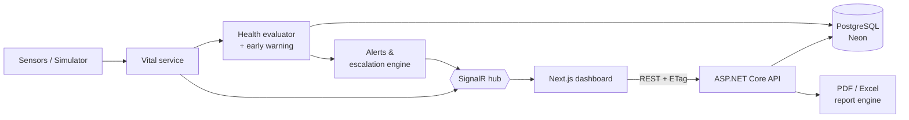

<div align="center">

# V I T A

**Vital Integrated Telemetry for Astronauts**

Real-time crew health monitoring for long-duration space missions.

[](https://www.spaceappschallenge.org/)
[](https://dotnet.microsoft.com/)
[](https://nextjs.org/)
[](https://neon.tech/)
[](https://learn.microsoft.com/aspnet/core/signalr/introduction)

[Challenge](#the-challenge) · [Product tour](#product-tour) · [Features](#features) · [Design](#design-system) · [Architecture](#architecture) · [Getting started](#getting-started) · [API](#api)

<br />



</div>

---

## The challenge

Built for the **2026 NASA Space Apps Challenge**: *Create Health Monitoring Software for Astronauts on Space Missions*.

Long-duration missions expose crews to radiation, isolation, altered gravity and limited medical support. Far from Earth, the crew and flight surgeons have to spot deterioration early and act on it, often before any single reading crosses a limit.

## Our solution

VITA is a mission-control platform that streams every astronaut's vitals in real time, checks each reading against clinical safe ranges, and turns raw telemetry into clear, prioritised action. It is organised around the **five hazards of human spaceflight** identified by NASA's Human Research Program: space radiation, isolation and confinement, distance from Earth, gravity fields, and hostile or closed environments.

| | |
|---|---|
| **See** | The whole crew's health on one screen, updating live. |
| **Catch** | Problems early, with an early-warning score and trend prediction rather than fixed limits alone. |
| **Act** | Through an alert workflow that escalates on its own when nobody responds. |
| **Report** | With print-ready medical PDFs and analyst-grade Excel workbooks. |

The interface follows one rule: **calm by default, loud only when it matters.** Surfaces stay neutral, so a critical value is the only thing on the screen that draws the eye.

## Product tour

<table>
  <tr>
    <td width="50%"></td>
    <td width="50%"></td>
  </tr>
  <tr>
    <td align="center"><sub><b>Overview</b> in dark theme</sub></td>
    <td align="center"><sub><b>Live monitor</b> with a real-time alert notification</sub></td>
  </tr>
</table>

| Page | What it is for |
|---|---|
| **Overview** | Summary cards, the five-hazards strip, the live crew vitals table, the action queue, the fleet trend chart, trend watch and the activity feed. |
| **Hazards** | Every crew member assessed against the five NASA hazards, live cabin environment per spacecraft, signal delay to Earth and onboard checklists. |
| **Live monitor** | One bedside-style tile per crew member, with auto-cycling and a full-screen wall mode. |
| **Alerts** | The alert console: status and severity filters, multi-select, and bulk acknowledge or resolve. |
| **Event log** | Every real-time message this session. You can pause it, search it and export it to CSV. |
| **Crew** | The roster in table or card view, plus a profile per astronaut with Overview, Trends, Wellness and Alerts tabs. |
| **Missions** | Missions with their elapsed-time clocks, crew and status. |
| **Protocols** | Reference ranges, alert rules and the early-warning scoring table, rendered from the live API. |
| **System status** | Health of the API, the real-time uplink, the server and the telemetry source. |

## Features

### The five hazards of human spaceflight

| Hazard (NASA HRP) | What VITA monitors |
|---|---|
| **Space radiation** | Personal dosimeter **dose rate** (mSv/day), the cabin area monitor, and the **mission dose against NASA's 600 mSv career limit**, with days remaining at the current rate. Solar particle events raise a critical alert with a storm-shelter checklist. |
| **Isolation and confinement** | Nightly **wrist actigraphy** (sleep, efficiency, activity, light exposure), modelled on NASA's ARCHeR study on Artemis II, plus a daily **mood, stress and workload check-in**. Sleep debt and low mood are flagged. |
| **Distance from Earth** | One-way **signal delay** per destination (Moon about 1.3 s, Mars 3 to 22 min). Beyond the Moon, VITA switches to **Earth-independent operations**: every alert carries an **onboard first-response checklist**. |
| **Gravity fields** | Heart rate and blood pressure against safe ranges (cardiovascular adaptation) and days spent in reduced gravity. |
| **Hostile and closed environments** | Live **cabin CO₂, oxygen, pressure, temperature and humidity** per spacecraft, plus each crew member's blood oxygen (hypoxia). |

The Protocols page maps every NASA HRP risk to the VITA feature that covers it and lists all sources.

### Monitoring
- **Live crew vitals table.** Shows heart rate, SpO₂, blood pressure, temperature, respiration, early-warning score and a 10-minute heart-rate trace for every crew member. A cell is highlighted briefly when its value changes, and any value outside its safe range takes its status colour. You can sort the columns and filter to "Needs attention".
- **Quick view.** Clicking any crew member opens a side panel with their vitals plotted against safe bands, the early-warning breakdown and their open alerts. The page underneath stays in place.
- **Fleet trend.** A chart of the crew average and min–max spread for one vital, drawn over its safe range, to answer "is the whole crew drifting?".
- **Signal quality.** Every stream shows whether it is *live*, *stale* or has *no signal*.

### Clinical intelligence
- **Reference ranges** based on NASA-STD-3001 for seven vital signs.
- **Early Warning Score** adapted from NEWS2, on a 0–15 scale.
- **Trend watch.** Fits a line to each vital over the last 60 minutes, flags only sustained drift, and estimates when a safe limit will be crossed.
- **Radiation judged correctly.** Limits apply to the dose *rate* and the accumulated mission dose, not to a single reading. Background rates are calibrated to published measurements (ISS about 0.5, lunar surface about 1.4, deep space about 1.8 mSv/day).

### Alerting and escalation
- Every alert follows an `Open → Acknowledged → Resolved` lifecycle. Repeat findings are de-duplicated, and an alert that worsens raises a new one.
- A critical alert that stays unacknowledged for **2 minutes** triggers a **master alarm**: a full-screen takeover, an alarm tone and a desktop notification. It then climbs one level every 5 minutes.
- The **action queue** on the Overview and **bulk actions** in the Alerts page let you clear alerts in seconds.

### Reports
- **PDF** fleet and medical reports with vector charts.
- **Excel** workbooks with real tables, live conditional formatting and formula-driven summaries.
- Reports are generated on the server, with live progress in a notification. You can keep working while a report builds.

### Built for speed
- **Command palette** (`Ctrl/⌘ K`) to jump to any crew member or page, or to run actions such as export, change theme or change table density.
- **Keyboard navigation** in the style of Linear (see [shortcuts](#keyboard-shortcuts)).
- **Settings** menu for theme (light, dark or system), compact tables, alarm sounds and desktop alerts.
- **Fully responsive.** Phones get a bottom tab bar, a menu drawer and a card layout for the crew vitals. The full sidebar appears from 1024 px and collapses to an icon rail.
- **Offline tolerant.** Data is cached in the browser, revisits render instantly, and polling takes over when the real-time link drops.

### Keyboard shortcuts

| Keys | Action |
|---|---|
| `Ctrl/⌘ K` or `/` | Open the command palette |
| `G` then `O` / `M` / `H` / `A` / `E` | Go to Overview / Live monitor / Hazards / Alerts / Event log |
| `G` then `C` / `I` | Go to Crew / Missions |
| `G` then `P` / `S` | Go to Protocols / System status |
| `[` | Collapse or expand the sidebar |
| `?` | Show all shortcuts |
| `Esc` | Close a panel or dialog |

## Design system

VITA has an enterprise look: minimal, neutral and quiet, with every visual decision serving clinical clarity.

| | |
|---|---|
| **Typography** | [Inter](https://rsms.me/inter/) for the interface, with tabular figures so live numbers never shift. JetBrains Mono for timestamps and clocks. |
| **Wordmark** | No logo, only the name: wide-tracked "VITA", where the full stop is a live uplink indicator (green when live, red when offline). |
| **Colour** | Neutral surfaces with one accent (indigo `#5B6CFF`). Green, amber and red are reserved for health status and never used as decoration. |
| **Themes** | Light by default, plus a tuned dark theme. Both are built from the same tokens in [`globals.css`](frontend/src/app/globals.css). |
| **Motion** | Transitions of 150–250 ms on `transform` and `opacity` only. Only a critical status pulses. `prefers-reduced-motion` is respected. |
| **Accessibility** | Visible focus rings, keyboard operability throughout, ARIA roles on custom controls, and contrast-safe status fills. |

## Architecture



The backend follows **Clean Architecture**. The clinical rules live in a domain layer with no dependencies, so they are fully unit-tested and shared by the API and the reports.

```
backend/
  src/
    AstroHealth.Domain           Entities, health evaluator, early-warning score, trend analysis,
                                 five hazards: space environment, habitat, wellness, crew playbook
    AstroHealth.Application      Use cases, contracts, validation, escalation, report assembly
    AstroHealth.Infrastructure   EF Core (PostgreSQL / SQLite), migrations, background services, PDF/Excel rendering
    AstroHealth.Api              Minimal APIs, SignalR hub, caching, ProblemDetails, rate limiting
  tests/AstroHealth.Tests        Unit and integration tests

frontend/src/
  app/                           Routes (App Router): overview, monitor, alerts, events, crew, missions, protocols, system
  components/
    shell/                       Sidebar, top bar, wordmark, command palette, shortcuts, settings
    overview/                    Crew vitals table, fleet trend
    hazards/                     Hazard matrix and summary, cabin environment, radiation budget, onboard checklists
    ui/                          Design-system primitives: buttons, inputs, dialogs, drawer, popover, badges, charts
    alerts/ crew/ monitor/ …     Feature components
  lib/                           API client and queries, real-time store, theme and preferences, vitals helpers
```

## Tech stack

| Layer | Technology |
|---|---|
| **API** | .NET 10, ASP.NET Core Minimal APIs, SignalR, EF Core 10, FluentValidation, OpenAPI + Scalar |
| **Data** | PostgreSQL on Neon (production) · SQLite (zero-setup local development) |
| **Reports** | QuestPDF (PDF) · ClosedXML (Excel) |
| **Frontend** | Next.js 16 (App Router, Cache Components), React 19, TypeScript, Tailwind CSS 4, TanStack Query, Recharts, cmdk, Zod |
| **Quality** | xUnit unit and integration tests, typed API contracts, strict TypeScript and ESLint |

## Getting started

**Prerequisites:** [.NET 10 SDK](https://dotnet.microsoft.com/download) and [Node.js 20+](https://nodejs.org/).

```bash
git clone https://github.com/Nav33dCodes/vita-astronaut-health-monitor.git
cd vita-astronaut-health-monitor
```

**1. Start the API** on http://localhost:5080. Interactive API docs are at http://localhost:5080/scalar.

```bash
cd backend
dotnet run --project src/AstroHealth.Api
```

Development uses a local SQLite database out of the box. On startup the API seeds demo missions and crew and streams simulated telemetry, so there is nothing to set up.

**2. Start the dashboard** on http://localhost:3000.

```bash
cd frontend
cp .env.example .env.local
npm install
npm run dev
```

Open http://localhost:3000. Live data starts flowing within a few seconds.

<details>
<summary><b>Use PostgreSQL (Neon) instead of SQLite</b></summary>

Secrets are stored with `dotnet user-secrets`, outside the repository. Neon's `postgresql://` URLs are accepted as-is.

```bash
cd backend
dotnet user-secrets set "Database:Provider" "Postgres" --project src/AstroHealth.Api
dotnet user-secrets set "ConnectionStrings:Default" "postgresql://<user>:<password>@<host>-pooler.<region>.aws.neon.tech/neondb?sslmode=require" --project src/AstroHealth.Api
```

Migrations run automatically on startup over Neon's direct endpoint, and the app itself uses the pooled endpoint.

In production, set `ConnectionStrings__Default` and `Database__Provider=Postgres` as environment variables.
</details>

<details>
<summary><b>Configuration</b></summary>

| Setting | Purpose | Default |
|---|---|---|
| `Simulator:Enabled` / `IntervalSeconds` | Simulated sensor stream for crew on active missions | On in Development, 5 s |
| `Escalation:CriticalAckMinutes` / `WarningAckMinutes` / `RepeatMinutes` | Escalation timing | 2 / 15 / 5 min |
| `Retention:RawRetentionDays` / `RollupRetentionDays` | Raw telemetry and hourly rollup retention | 7 / 730 days |
| `Cors:AllowedOrigins` | Allowed frontend origins | `http://localhost:3000` in Development |
| `NEXT_PUBLIC_API_URL` (frontend) | Base URL of the API | `http://localhost:5080` |

</details>

<details>
<summary><b>Production build of the dashboard</b></summary>

```bash
cd frontend
npm run build
npm start
```

</details>

## API

REST endpoints are versioned under `/api/v1`. The full interactive reference is at `/scalar` when running in Development.

| Area | Endpoints |
|---|---|
| Dashboard | `GET /dashboard/summary` |
| Crew | `GET·POST /astronauts` · `GET·PUT·DELETE /astronauts/{id}` |
| Vitals | `GET·POST /astronauts/{id}/vitals` · `GET …/vitals/series` · `GET …/vitals/stats` · `GET /telemetry/snapshot` |
| Alerts | `GET /alerts` · `POST /alerts/{id}/acknowledge` · `POST /alerts/{id}/resolve` |
| Early warning | `GET /assessments` · `GET /astronauts/{id}/assessment` · `GET /early-warning/scoring` |
| Hazards | `GET /hazards` · `GET /hazards/playbook` · `GET /habitat/thresholds` · `GET·POST /missions/{id}/habitat` · `GET /astronauts/{id}/wellness` · `POST /astronauts/{id}/wellness/check-in` |
| Missions | `GET·POST /missions` · `GET·PUT·DELETE /missions/{id}` · `PATCH /missions/{id}/status` |
| Reports | `GET /reports/fleet.pdf` · `/reports/crew.xlsx` · `/reports/alerts.xlsx` · `/reports/astronauts/{id}.pdf` · `/reports/astronauts/{id}/vitals.xlsx` |
| System | `GET /system/status` · `GET /vitals/thresholds` · `/health/live` · `/health/ready` |
| Real-time | SignalR hub at `/hubs/telemetry`, with the events `ReadingRecorded`, `HabitatUpdated`, `AlertRaised`, `AlertUpdated` and `AlertEscalated` |

## Testing

```bash
# Backend: unit and integration tests
cd backend
dotnet test

# Frontend: type-check, lint and production build
cd frontend
npx tsc --noEmit
npm run lint
npm run build
```

The backend tests cover the clinical rules, the early-warning score, trend detection, escalation, data retention, real-time events, HTTP caching, report generation, and the five-hazards logic (radiation dose rate and mission dose, cabin limits, sleep debt and check-ins, signal delay and onboard checklists).

## Roadmap

- Authentication with role-based access (flight surgeon, commander, crew) and a full audit trail
- An ingestion endpoint for real wearable sensors and dosimeters
- EVA (spacewalk) mode: suit pressure, oxygen and CO₂ with decompression-sickness risk
- Exercise countermeasure logging for bone and muscle loss
- Docker Compose and a CI pipeline

## Sources

- NASA Human Research Program: [the five hazards of human spaceflight](https://www.nasa.gov/hrp/hazards/), the risks of human spaceflight and the [Human Research Roadmap](https://www.nasa.gov/hrp/)
- NASA Human Research Program: ARCHeR (activity, sleep and light monitoring on Artemis II)
- Canadian Space Agency (2026): Canadian Active Neutron Spectrometer (CANS), radiation monitoring for astronaut health
- NASA-STD-3001 Volume 1, Rev B (2022): crew health standards, including the 600 mSv career dose limit
- Zeitlin et al., *Science* (2013): radiation in transit to Mars measured by Curiosity RAD (about 1.8 mSv/day)
- Zhang et al., *Science Advances* (2020): first radiation dose measurements on the lunar surface by Chang'e 4 LND (about 1.4 mSv/day)

NASA does not endorse any non-U.S. Government entity and is not responsible for information on non-U.S. Government websites.

## Disclaimer

VITA is a hackathon prototype for demonstration purposes. Its reference ranges are loosely based on NASA-STD-3001, its early-warning score is adapted from NEWS2 (Royal College of Physicians), and its onboard checklists are illustrative. Telemetry is simulated, calibrated to the published figures above. **It is not a medical device and must not be used for clinical decisions.**

<div align="center">
<sub>Built for the 2026 NASA Space Apps Challenge · <i>The Next Frontier</i></sub>
</div>
