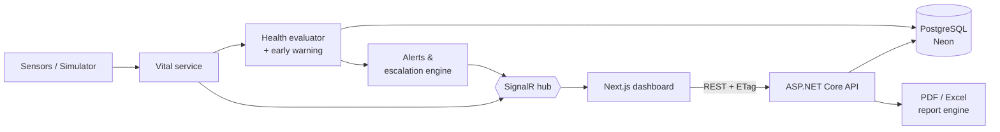

<div align="center">


# VITA

**Vital Integrated Telemetry for Astronauts**

Real-time crew health monitoring for long-duration space missions.

[](https://www.spaceappschallenge.org/)
[](https://dotnet.microsoft.com/)
[](https://nextjs.org/)
[](https://neon.tech/)
[](https://learn.microsoft.com/aspnet/core/signalr/introduction)

[Challenge](#the-challenge) · [Features](#features) · [Architecture](#architecture) · [Getting started](#getting-started) · [API](#api)

</div>

---

## The challenge

Built for the **2026 NASA Space Apps Challenge**: *Create Health Monitoring Software for Astronauts on Space Missions*.

Long-duration missions expose crews to radiation, isolation, altered gravity and limited medical support. On a mission far from Earth, the crew and flight surgeons need to spot deterioration early and act on it, often before a single reading crosses a limit.

## Our solution

VITA is a mission-control style platform that streams every astronaut's vitals in real time, evaluates each reading against clinical safe ranges, and turns raw telemetry into clear, prioritised action:

- **See** the whole crew's health at a glance, live.
- **Catch** problems early with an early-warning score and trend detection, not just fixed limits.
- **Act** through an alert workflow that escalates automatically when nobody responds.
- **Report** with print-ready medical PDFs and analyst-grade Excel workbooks.

## Features

| | |
|---|---|
| **Live monitoring** | Bedside-monitor view of every crew member over SignalR, with heart rate, SpO₂, blood pressure, temperature, respiration and radiation. Signal quality (live, stale or lost) is shown for each stream, and an auto-cycling wall-display mode is available. |
| **Clinical alerting** | Every reading is checked against reference ranges based on NASA-STD-3001. Repeated findings are de-duplicated, an alert that worsens is escalated, and every alert follows an `Open → Acknowledged → Resolved` lifecycle. |
| **Automatic escalation** | A critical alert left unacknowledged for 2 minutes triggers a full-screen master alarm, an alarm tone and a desktop notification. It climbs one level every 5 minutes after that. |
| **Early warning** | Early Warning Score adapted from NEWS2, on a 0–15 scale. Trend detection fits a line to the last 60 minutes, reports only real deterioration, and estimates when a safe limit will be crossed. |
| **Reports** | PDF medical and fleet reports with vector charts. Excel workbooks contain real tables, live conditional formatting and formula-driven summaries. Reports are generated on the server and show live progress in the app. |
| **Operations** | Missions, crew roster, alert console, live event log, system status and protocol reference pages. |
| **Built to run** | ETag/304 and Brotli compression, output caching, offline-tolerant client cache, data retention with hourly rollups, rate limiting and health probes. |

## Architecture



The backend follows **Clean Architecture**. Clinical rules live in a dependency-free domain layer, so they are fully unit-tested and reused by both the API and the reports.

```
backend/
  src/
    AstroHealth.Domain           Entities, health evaluator, early-warning score, trend analysis
    AstroHealth.Application      Use cases, contracts, validation, escalation, report assembly
    AstroHealth.Infrastructure   EF Core (PostgreSQL), migrations, background services, PDF/Excel rendering
    AstroHealth.Api              Minimal APIs, SignalR hub, caching, ProblemDetails, rate limiting
  tests/AstroHealth.Tests        Unit + integration tests
frontend/                        Next.js 16 app (App Router)
docs/assets/                     Brand and challenge assets
```

## Tech stack

| Layer | Technology |
|---|---|
| **API** | .NET 10, ASP.NET Core Minimal APIs, SignalR, EF Core 10, FluentValidation, OpenAPI + Scalar |
| **Data** | PostgreSQL on Neon (production) · SQLite (zero-setup local development) |
| **Reports** | QuestPDF (PDF) · ClosedXML (Excel) |
| **Frontend** | Next.js 16, React 19, TypeScript, Tailwind CSS 4, TanStack Query, Recharts, Zod |
| **Quality** | xUnit unit and integration tests, typed API contracts, strict TypeScript and ESLint |

## Getting started

**Prerequisites:** [.NET 10 SDK](https://dotnet.microsoft.com/download) and [Node.js 20+](https://nodejs.org/).

```bash
git clone https://github.com/Nav33dCodes/vita-astronaut-health-monitor.git
cd vita-astronaut-health-monitor
```

**1. Start the API** on http://localhost:5080. Interactive docs are at `/scalar`.

```bash
cd backend
dotnet run --project src/AstroHealth.Api
```

Out of the box, development uses a local SQLite database. On startup the API seeds demo missions and crew and streams simulated telemetry, so no setup is needed.

**2. Start the dashboard** on http://localhost:3000.

```bash
cd frontend
cp .env.example .env.local
npm install
npm run dev
```

<details>
<summary><b>Use PostgreSQL (Neon) instead of SQLite</b></summary>

Secrets are stored with `dotnet user-secrets`, outside the repository. Neon's `postgresql://` URLs are accepted as-is.

```bash
cd backend
dotnet user-secrets set "Database:Provider" "Postgres" --project src/AstroHealth.Api
dotnet user-secrets set "ConnectionStrings:Default" "postgresql://<user>:<password>@<host>-pooler.<region>.aws.neon.tech/neondb?sslmode=require" --project src/AstroHealth.Api
```

Migrations run automatically on startup over Neon's direct endpoint. The app itself uses the pooled endpoint.

In production, set `ConnectionStrings__Default` and `Database__Provider=Postgres` as environment variables.
</details>

<details>
<summary><b>Configuration</b></summary>

| Setting | Purpose | Default |
|---|---|---|
| `Simulator:Enabled` / `IntervalSeconds` | Simulated sensor stream for crew on active missions | on in Development, 5 s |
| `Escalation:CriticalAckMinutes` / `WarningAckMinutes` / `RepeatMinutes` | Escalation timing | 2 / 15 / 5 min |
| `Retention:RawRetentionDays` / `RollupRetentionDays` | Raw telemetry and hourly rollup retention | 7 / 730 days |
| `Cors:AllowedOrigins` | Allowed frontend origins | `http://localhost:3000` in Development |

</details>

## API

REST endpoints are versioned under `/api/v1`. The full interactive reference is at `/scalar` when running in Development.

| Area | Endpoints |
|---|---|
| Dashboard | `GET /dashboard/summary` |
| Crew | `GET·POST /astronauts` · `GET·PUT·DELETE /astronauts/{id}` |
| Vitals | `GET·POST /astronauts/{id}/vitals` · `GET …/vitals/series` · `GET …/vitals/stats` · `GET /telemetry/snapshot` |
| Alerts | `GET /alerts` · `POST /alerts/{id}/acknowledge` · `POST /alerts/{id}/resolve` |
| Early warning | `GET /assessments` · `GET /astronauts/{id}/assessment` · `GET /early-warning/scoring` |
| Missions | `GET·POST /missions` · `GET·PUT·DELETE /missions/{id}` · `PATCH /missions/{id}/status` |
| Reports | `GET /reports/fleet.pdf` · `/reports/crew.xlsx` · `/reports/alerts.xlsx` · `/reports/astronauts/{id}.pdf` · `/reports/astronauts/{id}/vitals.xlsx` |
| System | `GET /system/status` · `GET /vitals/thresholds` · `/health/live` · `/health/ready` |
| Real-time | SignalR hub at `/hubs/telemetry`, with the events `ReadingRecorded`, `AlertRaised`, `AlertUpdated` and `AlertEscalated` |

## Testing

```bash
cd backend
dotnet test
```

The 74 unit and integration tests cover the clinical rules, the early-warning score, trend detection, escalation, data retention, real-time events, HTTP caching and report generation.

## Roadmap

- Authentication with role-based access (flight surgeon, commander, crew) and a full audit trail
- Ingestion endpoint for real wearable sensors
- Docker Compose and a CI pipeline
- Wall-display mode enhancements, fleet heatmap and accessibility refinements

## Disclaimer

VITA is a hackathon prototype for demonstration purposes. Its reference ranges are loosely based on NASA-STD-3001, and its early-warning score is adapted from NEWS2 (Royal College of Physicians). **It is not a medical device and must not be used for clinical decisions.**

<div align="center">
<sub>Built for the 2026 NASA Space Apps Challenge · <i>The Next Frontier</i></sub>
</div>
